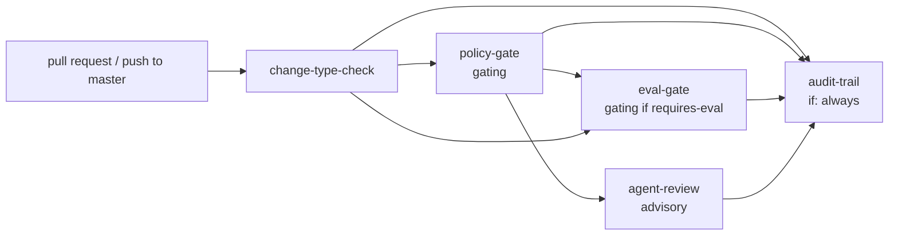

# CI Step Design

The design of GIMPL's governed CI pipeline, `.github/workflows/ci.yml`. Each job below has one purpose, a stated input and output, an authority with its reason, a time limit and the exact credentials it holds. The workflow must match this document. `eval/test_policy.py` reads the classifications here and fails the Policy Test Suite where `ci.yml` disagrees, so a change to one is a change to both in the same commit.

## Pipeline at a glance

| Job key | Display name | Authority | Runs | Report artifact |
|---|---|---|---|---|
| `change-type-check` | Change Classifier | informational | every run | `change-classification.json` |
| `policy-gate` | Policy Test Suite | **gating, permanent** | every run | `policy-report.json` |
| `eval-gate` | Evaluation Harness | **gating, conditional** | every run; heavy work only on agent-affecting changes | `eval-report.json`, `eval-tests-report.json` |
| `agent-review` | Advisory Code Review | advisory | pull requests | `review-audit.json`, `review-output.md`, PR comment |
| `audit-trail` | Audit Trail | informational, always runs | every run, after all other jobs | `ci-audit-trail-<sha>.json`, PR comment |

## Rules that apply to every job

- **Triggers.** The workflow runs on every pull request and every push to `master`, with no `paths:` filter. A trigger filter would skip the whole workflow, required gates included, so changes would enter through the files it ignores. `change-type-check` decides inside the run which heavy work is needed.
- **Deterministic jobs run in the project image.** `policy-gate` and `eval-gate` build the `gimpl` image from the repository's `Dockerfile` and run their checks in it with the repository mounted read-only at `/workspace`, a separate writable `/reports` directory, `--network none` and no secrets. Neither suite needs the network: the policy suite reads files and dry-runs `scripts/run-agent.sh`, and the harness reads committed fixtures.
- **Image build.** The image is built with Docker Buildx and the GitHub Actions layer cache (`type=gha`, scope `gimpl-image`). `policy-gate` writes the cache, and the later jobs read it, so a run with no `Dockerfile` change reuses every layer. The image installs the CPU-only build of PyTorch, which keeps it small enough to build and cache well inside the time limits.
- **Untrusted values stay out of scripts.** Branch data such as changed file names reaches a `run:` script through `env:`, never through `${{ }}` text substitution, so a crafted file name cannot become a shell command.
- **Artifacts.** Every job uploads its report with `actions/upload-artifact@v4`, `if: always()` (failing runs keep their evidence) and `retention-days: 90`. Report files have distinct names, so the audit trail can merge them into one directory. Artifacts on this public repository can be downloaded by anyone who can see the run, so no job writes environment contents or credentials to a file.
- **Permissions.** The workflow token is `contents: read` by default. Only `agent-review` and `audit-trail` add `pull-requests: write`, to post their comments.

### Job states

Every job's outcome is recorded in the audit trail as exactly one state, so a job that failed is never confused with one that had nothing to do:

| State | Meaning |
|---|---|
| `passed` | The job ran its checks and they passed. |
| `failed` | The job ran and failed, or timed out. |
| `not_triggered` | The job ran but had nothing to check: the classifier found no agent-affecting change (`eval-gate`), or the job runs on pull requests only and the event was a push (`agent-review`). |
| `skipped` | The job did not run because a job it needs did not succeed, or it ran and recorded a skip (the reviewer with no key). |
| `cancelled` | The run was cancelled before the job finished. |

## Step: Change classifier (`change-type-check`)

- **Does:** Lists the files the change touches and sets the flags that decide which heavy work later jobs do.
- **Input:** The git diff between the pull request's base commit and the merge commit (or, on a push to `master`, between the previous and new head), from a full-history checkout (`fetch-depth: 0`).
- **Produces:** Job outputs `changed-files`, `requires-eval` and `touches-policy`, and the artifact `change-classification.json` with the base and head commits and both flags.
  - `requires-eval` is `true` when a change touches agent behaviour or the checks around it: `.claude/agents/`, `.claude/skills/`, `.claude/settings.json`, `.mcp.json`, `mcp/`, `eval/`, `scripts/hooks/`, `scripts/run-agent.sh`, `scripts/run-eval-gate.py`, `docs/governance-policy.md`, `docs/routing-and-tool-grant-map.md`, `CLAUDE.md`, or the image (`Dockerfile`, `docker-entrypoint.sh`, `requirements-ci.txt`, `requirements-mcp.txt`).
  - `touches-policy` is `true` when a change touches a file that grants or limits access, or the checks that guard it: `docs/governance-policy.md`, the MCP allow-lists, `scripts/run-agent.sh`, `scripts/hooks/`, the agent, skill and settings files under `.claude/`, `eval/test_policy.py` and `.github/workflows/`.
  - If the diff cannot be computed, both flags are set to `true`, so the classifier fails safe and the eval gate runs.
- **Classification:** informational; never blocks. It only routes work. A wrong `false` is the risk it must avoid, which is why it fails safe, and `eval/test_policy.py` checks that every file the policy suite treats as enforcement sets `requires-eval`.
- **Time limit:** 2 minutes.
- **Credentials:** none (read-only checkout).
- **Verified:** pending the first pull request run.

## Step: Policy test suite (`policy-gate`)

- **Does:** Runs `eval/test_policy.py`, which fails wherever `docs/governance-policy.md` and the artifacts that enforce it disagree, and wherever `ci.yml` disagrees with this design.
- **Input:** The whole repository: the policy document; `mcp/storage/allow-list.json`, `mcp/retrieval/allow-list.json` and the `_authorize()` guard in both servers; the agent files in `.claude/agents/` and `.claude/settings.json`; the case block in `scripts/run-agent.sh` (run in dry-run mode); and `.github/workflows/ci.yml` with this document.
- **Produces:** `policy-report.json` (pytest JSON report, one entry per check), uploaded as the `policy-report` artifact, and the job's pass or fail status.
- **Classification:** gating, permanent. The checks are deterministic, need no model and no secret, and a failure always means the written policy and the real enforcement have drifted apart. Nothing else should run on that foundation, so every other job except the classifier waits for it. It is never advisory and never demoted: no `continue-on-error`, no job-level `if:` and no path filter. Branch protection on `master` lists **Policy Test Suite** as a required status check.
- **Time limit:** 5 minutes for the test step. The job is capped at 10 minutes, which includes building the image.
- **Credentials:** none.
- **Verified:** pending the first pull request run, and a test change that breaks one policy entry to show the gate failing.

## Step: Evaluation harness (`eval-gate`)

- **Does:** Runs GIMPL's Module 3 evaluation harness when a change can affect agent behaviour, and records a `not_triggered` result when it cannot.
- **Input:** The whole repository and the classifier's `requires-eval` output.
- **Produces:** `eval-report.json`, uploaded as the `eval-report` artifact with `eval-tests-report.json`, the pytest JSON report.
  - When `requires-eval` is `true`, `scripts/run-eval-gate.py` runs in the image. It runs `pytest eval/tests` (unit tests for the deterministic checks, the rubric suite's gate and the guard hooks). It then runs `eval/test_deterministic.py` on each committed fixture run in `eval/tests/fixtures/`: `valid` must exit 0, and `malformed`, `golden-changed` and `missing-tester` must each exit 1. A broken fixture that passes means a check stopped catching the fault it guards.
  - When `requires-eval` is `false`, the job skips the image build and writes `eval-report.json` with `"status": "not_triggered"` and the reason. The job still reports success, so a documentation-only pull request is never left waiting on a required check.
  - `eval/test_rubric_suite.py` does not run in CI. The rubric judge is Claude Code on the operator's interactive login, and CI holds no Claude credential. The report records `"rubric_judge": {"status": "not_run"}` with that reason rather than counting it as a pass. The rubric suite remains a local, operator-run check.
- **Classification:** gating, conditional. Agent definitions, skills, hooks, MCP servers and eval code can look harmless in a diff and still degrade behaviour on tasks the author never tried. Every check here is deterministic and fixture-based, so a failure is a real regression, not model noise. No `continue-on-error` and no job-level `if:`: the condition sits on the steps, so the job always reports a real result. Branch protection on `master` lists **Evaluation Harness** as a required status check.
- **Time limit:** 5 minutes for the harness step. The job is capped at 10 minutes, which includes building the image.
- **Credentials:** none. No check calls a model.
- **Verified:** pending the first pull request run (`requires-eval=true`) and a documentation-only change (`"status": "not_triggered"`).

## Step: Advisory code review (`agent-review`)

- **Does:** Sends the pull request's changed text files to a model through OpenRouter and posts the review as a pull request comment, without ever blocking the merge.
- **Input:** The classifier's `changed-files` list and those files' contents, read from the read-only checkout. Files under `.memory/`, `logs/` and `.eval-artifacts/`, and any `.env`, key or credentials file, are never sent.
- **Produces:** `review-output.md` (the review, also posted as a PR comment when a review ran) and `review-audit.json` (status `reviewed`, `skipped` or `error`, whether a key was present, the model, and which files were sent and why others were not), uploaded as the `agent-review` artifact.
- **Classification:** advisory; not a required status check. A review needs human judgment, and the step is new and unproven, so a wrong block would cost more than an occasional missed problem. Advisory is built in two layers: `scripts/run-reviewer.py` exits 0 on every path (a critical review, a missing key, an API error), and the job sets `continue-on-error: true` as a backstop. It can be promoted to a gate only on recorded evidence, such as a false-positive rate under 10% over a meaningful sample on a stable harness, entered in `docs/calibration-log.md`.
- **Time limit:** 15 minutes for the job; 5 minutes for the reviewer step.
- **Credentials:** `CI_REVIEWER_OPENROUTER_KEY`, a purpose-named CI secret used for nothing else, injected through `env:` into the reviewer step only and passed into the container by name (`-e CI_REVIEWER_OPENROUTER_KEY`). The comment step uses the workflow's `GITHUB_TOKEN` with `pull-requests: write`. An optional repository variable, `CI_REVIEWER_MODEL`, selects the model; it is not a secret.
  - The secret is declared but not stored. Until the operator adds a dedicated, spend-capped CI key in the repository's Actions secrets, the value is empty. The reviewer then calls no model, writes a skip note and `"status": "skipped"`, `"key_present": false`, and exits 0. The operator's interactive Claude login and container key are never stored in GitHub.
  - Rotation needs no pipeline change: the workflow refers only to the secret's name.
  - To confirm a newly added key arrives without exposing it, a temporary step may print its length (`${#CI_REVIEWER_OPENROUTER_KEY}`), never its value. That step is removed before merging.
- **Verified:** pending the first pull request run (expected: `skipped`, `key_present: false`, job green).

## Step: Audit trail (`audit-trail`)

- **Does:** Combines every report from the run into one JSON record and posts a summary, whatever the other jobs did.
- **Input:** Every artifact the run uploaded, downloaded into one directory with `actions/download-artifact@v4` (no artifact name, `merge-multiple: true`), plus each job's result from the `needs` context and the run's metadata.
- **Produces:** `ci-audit-trail-<sha>.json` and `ci-audit-trail-summary.md`, uploaded as the `audit-trail` artifact (`if-no-files-found: error`), with the summary in the job summary and as a pull request comment. The trail holds:
  - CI metadata: commit SHA, event, pull request number, run ID and run URL;
  - the change classification: changed files, `requires-eval` and the policy-relevant flag `touches-policy`;
  - each job's authority, result and state (`passed`, `failed`, `not_triggered`, `skipped`, `cancelled`), with `skipped_states` listing every job that did not run its checks;
  - policy results and harness results, including failed test names and the rubric judge's `not_run` state;
  - agent actions (the advisory review's audit record) and any authorization denials found in uploaded audit logs;
  - an overall verdict, `failed` if any gating job failed, was cancelled or never ran.
- **Classification:** informational; always runs. `needs:` lists every other job and `if: always()` overrides the default success condition, because failing runs are the ones an auditor most needs to reconstruct. It is not a required status check.
- **Time limit:** 5 minutes.
- **Credentials:** `GITHUB_TOKEN` with `pull-requests: write`, for the summary comment only. `scripts/build-audit-trail.py` reads only the downloaded report files and its arguments, never the environment, and masks anything shaped like an API key as a backstop.
- **Verified:** pending the first pull request run, and a run with a failing gate to show the trail is still produced.

## Branch protection

The `master` branch rule requires a pull request and these status checks: **Policy Test Suite** and **Evaluation Harness**. **Advisory Code Review** is never required while it is advisory, and the **Change Classifier** and **Audit Trail** record rather than decide, so they are not required either.
