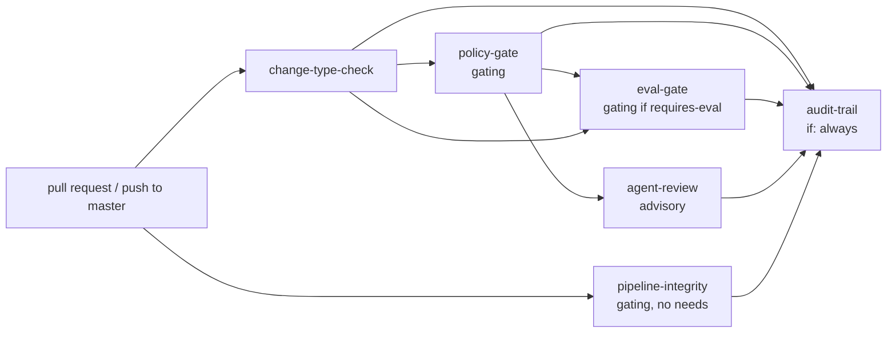

# CI Step Design

The design of GIMPL's governed CI pipeline, `.github/workflows/ci.yml`. Each job below has one purpose, a stated input and output, an authority with its reason, a time limit and the exact credentials it holds. The workflow must match this document. `eval/test_policy.py` reads the classifications here and fails the Policy Test Suite where `ci.yml` disagrees, so a change to one is a change to both in the same commit. `pipeline-integrity` checks the workflow's own guardrails separately, in a job that depends on no other job.

## Pipeline at a glance

| Job key | Display name | Authority | Runs | Report artifact |
|---|---|---|---|---|
| `change-type-check` | Change Classifier | informational | every run | `change-classification.json` |
| `policy-gate` | Policy Test Suite | **gating, permanent** | every run | `policy-report.json` |
| `eval-gate` | Evaluation Harness | **gating, conditional** | every run; heavy work only on agent-affecting changes | `eval-report.json`, `eval-tests-report.json` |
| `agent-review` | Advisory Code Review | advisory | pull requests | `review-audit.json`, `review-output.md`, PR comment |
| `pipeline-integrity` | Pipeline Integrity Check | **gating, permanent** | every run, needs no other job | `pipeline-integrity-report.json` |
| `audit-trail` | Audit Trail | informational, always runs | every run, after all other jobs | `ci-audit-trail-<sha>.json`, PR comment |

## Rules that apply to every job

- **Triggers.** The workflow runs on every pull request and every push to `master`, with no `paths:` filter. A trigger filter would skip the whole workflow, required gates included, so changes would enter through the files it ignores. `change-type-check` decides inside the run which heavy work is needed.
- **Deterministic jobs run in the project image.** `policy-gate` and `eval-gate` build the `gimpl` image from the repository's `Dockerfile` and run their checks in it with the repository mounted read-only at `/workspace`, a separate writable `/reports` directory, `--network none` and no secrets. Neither suite needs the network: the policy suite reads files and dry-runs `scripts/run-agent.sh`, and the harness reads committed fixtures. `pipeline-integrity` is the one gate that runs on the runner instead, with Python 3.12 and the pinned PyYAML, so that a broken `Dockerfile` cannot stop it from reporting.
- **Image build.** The image is built with Docker Buildx and the GitHub Actions layer cache (`type=gha`, scope `gimpl-image`). `policy-gate` writes the cache, and the later jobs read it, so a run with no `Dockerfile` change reuses every layer. The image installs the CPU-only build of PyTorch, which keeps it small enough to build and cache well inside the time limits.
- **Untrusted values stay out of scripts.** Branch data such as changed file names reaches a `run:` script through `env:`, never through `${{ }}` text substitution, so a crafted file name cannot become a shell command.
- **Artifacts.** Every job uploads its report with `actions/upload-artifact@v4`, `if: always()` (failing runs keep their evidence) and `retention-days: 90`. Report files have distinct names, so the audit trail can merge them into one directory. Artifacts on this public repository can be downloaded by anyone who can see the run, so no job writes environment contents or credentials to a file.
- **Permissions.** The workflow token is `contents: read` by default. Only `agent-review` and `audit-trail` add `pull-requests: write`, to post their comments.

### Job states

Every job's outcome is recorded in the audit trail as exactly one state, so a job that failed is never confused with one that had nothing to do:

| State | Meaning |
|---|---|
| `passed` | The job ran its checks and they passed. |
| `failed` | The job ran and failed, or timed out. |
| `not_triggered` | The job ran but had nothing to check: the classifier found no agent-affecting change (`eval-gate`), or the job runs on pull requests only and the event was a push (`agent-review`). |
| `skipped` | The job did not run because a job it needs did not succeed or its own `if:` was false, or it ran and recorded a skip (the reviewer with no key). |
| `cancelled` | The run was cancelled before the job finished. |

A gate's own result is not taken on trust. When a gating job reports success but its report records a failure (a pytest report with a non-zero exit code, or `"status": "failed"`), or it uploaded no report, the audit trail records it as `failed` and says why. That keeps a gate demoted with `continue-on-error` from appearing in the record as `passed`.

## Change classifier (`change-type-check`)

- **Does:** Lists the files the change touches and sets the flags that decide which heavy work later jobs do.
- **Input:** The git diff between the pull request's base commit and the merge commit (or, on a push to `master`, between the previous and new head), from a full-history checkout (`fetch-depth: 0`).
- **Produces:** Job outputs `changed-files`, `requires-eval` and `touches-policy`, and the artifact `change-classification.json` with the base and head commits and both flags.
  - `requires-eval` is `true` when a change touches agent behaviour or the checks around it: `.claude/agents/`, `.claude/skills/`, `.claude/settings.json`, `.mcp.json`, `mcp/`, `eval/`, `scripts/hooks/`, `scripts/run-agent.sh`, `scripts/run-eval-gate.py`, `scripts/verify_demos_deterministic.py`, `docs/governance-policy.md`, `docs/routing-and-tool-grant-map.md`, `CLAUDE.md`, or the image (`Dockerfile`, `docker-entrypoint.sh`, `requirements-ci.txt`, `requirements-mcp.txt`).
  - `touches-policy` is `true` when a change touches a file that grants or limits access, or the checks that guard it: `docs/governance-policy.md`, the MCP allow-lists, `scripts/run-agent.sh`, `scripts/hooks/`, the agent, skill and settings files under `.claude/`, `eval/test_policy.py`, `scripts/check-pipeline-integrity.py` and `.github/workflows/`.
  - If the diff cannot be computed, both flags are set to `true`, so the classifier fails safe and the eval gate runs.
- **Classification:** informational; never blocks. It only routes work. A wrong `false` is the risk it must avoid, which is why it fails safe, and `eval/test_policy.py` checks that every file the policy suite treats as enforcement sets `requires-eval`.
- **Time limit:** 2 minutes.
- **Credentials:** none (read-only checkout).
- **Verified:** PR #1 (`m4/ci-cd`, merged as `ded36768`): passed in 7 seconds. That change touched `eval/`, `mcp/`, `CLAUDE.md` and the `Dockerfile`, so it set `requires-eval=true` and the harness ran.

## Policy test suite (`policy-gate`)

- **Does:** Runs `eval/test_policy.py`, which fails wherever `docs/governance-policy.md` and the artifacts that enforce it disagree, and wherever `ci.yml` disagrees with this design.
- **Input:** The whole repository: the policy document; `mcp/storage/allow-list.json`, `mcp/retrieval/allow-list.json` and the `_authorize()` guard in both servers; the agent files in `.claude/agents/` and `.claude/settings.json`; the case block in `scripts/run-agent.sh` (run in dry-run mode); and `.github/workflows/ci.yml` with this document.
- **Produces:** `policy-report.json` (pytest JSON report, one entry per check), uploaded as the `policy-report` artifact, and the job's pass or fail status.
- **Classification:** gating, permanent. The checks are deterministic, need no model and no secret, and a failure always means the written policy and the real enforcement have drifted apart. Nothing that depends on a sound policy should run on that foundation, so eval-gate and agent-review wait for it. pipeline-integrity does not, because it must still report if this gate is demoted or skipped. It is never advisory and never demoted: no `continue-on-error`, no job-level `if:` and no path filter. Branch protection on `master` lists **Policy Test Suite** as a required status check.
- **Time limit:** 5 minutes for the test step. The job is capped at 10 minutes, which includes building the image.
- **Credentials:** none.
- **Verified:** PR #1: passed, in 7 minutes on the first run with no layer cache and about 1 minute once the cache was warm. Commit `b4c6ada9` deliberately changed `write_entry` to `delete_entry` in `mcp/storage/allow-list.json`. Policy Test Suite failed, eval-gate and agent-review were skipped because they need it, and the audit trail still ran and recorded `overall: failed`. The revert, `50f6ad7d`, returned the run to green.

## Evaluation harness (`eval-gate`)

- **Does:** Runs GIMPL's Module 3 evaluation harness when a change can affect agent behaviour, and records a `not_triggered` result when it cannot.
- **Input:** The whole repository and the classifier's `requires-eval` output.
- **Produces:** `eval-report.json`, uploaded as the `eval-report` artifact with `eval-tests-report.json`, the pytest JSON report.
  - When `requires-eval` is `true`, `scripts/run-eval-gate.py` runs in the image. It runs `pytest eval/tests eval/test_deterministic_step.py` (unit tests for the deterministic checks, the rubric suite's gate, the guard hooks, and `scripts/verify_demos_deterministic.py`, the deterministic demo verifier that replaced the demo-verifier agent under ADR-001). It then runs `eval/test_deterministic.py` on each committed fixture run in `eval/tests/fixtures/`: `valid` must exit 0, and `malformed`, `golden-changed` and `missing-tester` must each exit 1. A broken fixture that passes means a check stopped catching the fault it guards.
  - When `requires-eval` is `false`, the job skips the image build and writes `eval-report.json` with `"status": "not_triggered"` and the reason. The job still reports success, so a documentation-only pull request is never left waiting on a required check.
  - `eval/test_rubric_suite.py` does not run in CI. The rubric judge is Claude Code on the operator's interactive login, and CI holds no Claude credential. The report records `"rubric_judge": {"status": "not_run"}` with that reason rather than counting it as a pass. The rubric suite remains a local, operator-run check.
- **Classification:** gating, conditional. Agent definitions, skills, hooks, MCP servers and eval code can look harmless in a diff and still degrade behaviour on tasks the author never tried. Every check here is deterministic and fixture-based, so a failure is a real regression, not model noise. No `continue-on-error` and no job-level `if:`: the condition sits on the steps, so the job always reports a real result. Branch protection on `master` lists **Evaluation Harness** as a required status check.
- **Time limit:** 5 minutes for the harness step. The job is capped at 10 minutes, which includes building the image.
- **Credentials:** none. No check calls a model.
- **Verified:** PR #1 (`requires-eval=true`): passed in about 1 minute. The `not_triggered` state, on runs that change only `ci.yml` or this document, is recorded in the pipeline-integrity entry's Verified field.

## Advisory code review (`agent-review`)

- **Does:** Sends the pull request's changed text files to a model through OpenRouter and posts the review as a pull request comment, without ever blocking the merge.
- **Input:** The classifier's `changed-files` list and those files' contents, read from the read-only checkout. Files under `.memory/`, `logs/` and `.eval-artifacts/`, and any `.env`, key or credentials file, are never sent.
- **Produces:** `review-output.md` (the review, also posted as a PR comment when a review ran) and `review-audit.json` (status `reviewed`, `skipped` or `error`, whether a key was present, the model, and which files were sent and why others were not), uploaded as the `agent-review` artifact.
- **Classification:** advisory; not a required status check. A review needs human judgment, and the step is new and unproven, so a wrong block would cost more than an occasional missed problem. Advisory is built in two layers: `scripts/run-reviewer.py` exits 0 on every path (a critical review, a missing key, an API error), and the job sets `continue-on-error: true` as a backstop. It can be promoted to a gate only on recorded evidence, such as a false-positive rate under 10% over a meaningful sample on a stable harness, entered in `docs/calibration-log.md`.
- **Time limit:** 15 minutes for the job; 5 minutes for the reviewer step.
- **Credentials:** `CI_REVIEWER_OPENROUTER_KEY`, a purpose-named CI secret used for nothing else, injected through `env:` into the reviewer step only and passed into the container by name (`-e CI_REVIEWER_OPENROUTER_KEY`). The comment step uses the workflow's `GITHUB_TOKEN` with `pull-requests: write`. An optional repository variable, `CI_REVIEWER_MODEL`, selects the model; it is not a secret.
  - The secret is declared but not stored. Until the operator adds a dedicated, spend-capped CI key in the repository's Actions secrets, the value is empty. The reviewer then calls no model, writes a skip note and `"status": "skipped"`, `"key_present": false`, and exits 0. The operator's interactive Claude login and container key are never stored in GitHub.
  - Rotation needs no pipeline change: the workflow refers only to the secret's name.
  - To confirm a newly added key arrives without exposing it, a temporary step may print its length (`${#CI_REVIEWER_OPENROUTER_KEY}`), never its value. That step is removed before merging.
- **Verified:** PR #1: job green, review `skipped` with no model called, because no CI key is stored. On the drift commit `b4c6ada9` the job was skipped because policy-gate failed.

## Pipeline integrity check (`pipeline-integrity`)

- **Does:** Reads `.github/workflows/ci.yml` itself, not the code change, and fails the run if the pipeline's own guardrails have been weakened: a gate demoted, the audit trail made skippable, or the classifier removed or switched off.
- **Input:** The workflow file in the run's checkout. On a pull request this is the pull request's own version of `ci.yml`. `scripts/check-pipeline-integrity.py` parses it with PyYAML 6.0.4, the `requirements-ci.txt` pin. It reads no diff, no other job's output and no artifact.
- **Checks:** four steps, one per guardrail. Each step runs one `--check`, prints `[PASS]` or `[FAIL]` with every finding, and adds a GitHub error annotation that names the check. Checks 2 to 4 run with `if: success() || failure()`, so every check is evaluated on every run and one failure never hides another.
  1. **Check 1: gates have no continue-on-error** (`--check gates`).
     - *Looks for:* `policy-gate` and `eval-gate` both exist. Neither the job nor any of its steps sets `continue-on-error` to anything but `false`, and an expression such as `${{ true }}` counts as set. Neither job has a job-level `if:`.
     - *Why:* these are the two jobs that block a merge on evidence.
     - *How a bad-faith pull request slips past the other five without it:* `continue-on-error: true` on policy-gate's "Run policy tests" step turns the Policy Test Suite check green while its tests fail. `eval/test_policy.py` does detect it, but the failure is swallowed by the step being demoted, so the one job that would object is the job being silenced. On the job instead, `continue-on-error` makes `needs.policy-gate.result` read `success`, so eval-gate and agent-review run as if policy passed, and the audit trail is handed `success` too. The trail now checks each gate's result against the gate's own report (see Job states), but before this exercise it recorded such a gate as `passed`. A job-level `if:` that evaluates false makes the gate report skipped, and branch protection counts a skipped required check as passing.
  2. **Check 2: audit-trail keeps if: always()** (`--check audit`).
     - *Looks for:* `audit-trail` exists. Its job-level `if:` is exactly `always()` (whitespace and `${{ }}` are ignored, so a narrowed `always() && ...` fails). Its `needs:` lists every other job in the file.
     - *Why:* `needs:` makes audit-trail wait for every job, and without `always()` GitHub skips it whenever any job it needs fails. Those failing runs are the ones an auditor most needs.
     - *How a bad-faith pull request slips past the other five without it:* removing the one line changes nothing on a green run, because the trail is still posted, so no job objects until a failing run produces no record at all. The policy suite's audit-trail test catches it only if the same pull request leaves `eval/test_policy.py` alone and policy-gate undemoted. Dropping a job from `needs:` removes that job's result from the record just as quietly.
  3. **Check 3: change-type-check classifier exists** (`--check classifier`).
     - *Looks for:* `change-type-check` exists, with no job-level `if:` and no `continue-on-error`. It still publishes `requires-eval`, and eval-gate still needs it and reads `needs.change-type-check.outputs.requires-eval` in its step conditions.
     - *Why:* the classifier decides whether the harness runs, and policy-gate, eval-gate and agent-review all need it.
     - *How a bad-faith pull request slips past the other five without it:* a plausible-looking `if: github.event_name == 'push'` on the classifier skips it on every pull request, and every job that needs it is skipped with it. Policy Test Suite, Evaluation Harness and Change Classifier then all report skipped, which branch protection counts as passing, and the policy suite never runs to notice. Deleting the job and its `needs:` entries leaves eval-gate's conditions reading an empty value, so the harness records `not_triggered` on every change, agent edits included, and stays green. Only a job that needs nothing still runs to object.
  4. **Check 4: pipeline-integrity stays independent** (`--check self`). This one goes beyond the three required checks.
     - *Looks for:* this job has no `needs:`, no job-level `if:` and no `continue-on-error`.
     - *Why:* a `needs: policy-gate` here would skip this job whenever policy fails, and a skipped required check passes. Check 4 catches an accidental change. It cannot stop a deliberate rewrite in the same pull request; see "Known limit" below.
- **Produces:** `pipeline-integrity-report.json`, uploaded as the artifact `pipeline-integrity-report` with `if: always()` and `retention-days: 90`. A final step, also `if: always()`, runs every check again and writes the report, so the report exists even when a check fails. It has the same shape as the other jobs' reports, with `job`, `status` (`passed` or `failed`), `timestamp` and `reason`, plus:
  - `workflow` and `workflow_sha256`: the file that was inspected, and the hash of its exact contents;
  - `checks`: one entry per check, with `id` (`gates`, `audit`, `classifier`, `self`), `step` (the step name in `ci.yml`), `looks_for`, `status` (`passed`, `failed` or `not_run`), `findings`, `reason`, `inspected` (the values read from the file) and `step_outcome` (that check step's `steps.<id>.outcome`);
  - `failed_checks` and `not_run_checks`.
  - **Not-run state.** Unlike eval-gate, this job has no `not_triggered` state. Any change can weaken the pipeline, the check takes seconds, and so it always applies. If a check cannot be evaluated (`ci.yml` is missing or does not parse, or PyYAML failed to install), it is recorded as `"status": "not_run"` with the reason. A check step that was skipped or cancelled shows in its `step_outcome`. Either one makes the report `"status": "failed"`, so a check that did not run never reads as a pass. If the job uploads no report at all, the audit trail records `reports_present["pipeline-integrity-report.json"]: false` and the job as `failed`.
- **Classification:** gating, permanent. It protects an invariant the pipeline depends on and that must always hold: the gates gate, the record is always written, and the classifier always routes. As with policy-gate, a failure is a fact about a file, found deterministically with no model and no secret, so a failure is never noise to tune out. Demoting it to advisory would reopen the exact gap it closes, so it is never a candidate for demotion. No `continue-on-error`, no job-level `if:` and no `needs:`.
- **Wiring:**
  - *No `needs:`.* It starts with the classifier, runs in parallel with everything else, and reports a result whether the other jobs pass, fail or are skipped.
  - *Required status check.* Branch protection on `master` lists **Pipeline Integrity Check**. A job that runs but is not required only adds a red X that a reviewer can merge past.
  - *In the audit trail.* `audit-trail` has `needs: [change-type-check, policy-gate, eval-gate, agent-review, pipeline-integrity]` and passes `--result "pipeline-integrity=..."` to `scripts/build-audit-trail.py`. The script reads `pipeline-integrity-report.json` (its `REPORTS` table) and treats the job as gating, so `overall` is `failed` if the job failed, was skipped or cancelled, or uploaded no report. It copies each check's result into `pipeline_integrity` in `ci-audit-trail-<sha>.json` and adds a "Pipeline integrity:" line to the summary comment.
  - *Checked by the policy suite.* `eval/test_policy.py` fails if the job gains a `needs:`, loses its display name or its one-step-per-check layout, stops writing or uploading its report with `if: always()`, or drops out of the audit script's `REPORTS` and `GATING`. It also runs the checker against nine weakened copies of `ci.yml` and requires that each one fail exactly the check that guards it.
- **Time limit:** 5 minutes for the job. Expected under a minute: checkout, Python setup, one `pip install` and four parses.
- **Credentials:** none. The workflow's default `contents: read` token, no secret, and the only file read is the workflow file.
- **Verified:** on throwaway PR #3 (`test/weaken-guardrails`, closed without merging), plus two local runs. Each pushed weakening changed only `.github/workflows/ci.yml`.
  - **Baseline.** PR #2, merged as `8197e834`. The audit comment on commit `5d108895` recorded `overall: passed`, `pipeline-integrity` as `passed`, and `Pipeline integrity: passed (gates passed, audit passed, classifier passed, self passed)`. `requires-eval` and `touches-policy` were both true (5 files changed). Pipeline Integrity Check finished in 8 seconds, Policy Test Suite in 2 minutes, Evaluation Harness in 2 minutes. Advisory Code Review was skipped (`CI_REVIEWER_OPENROUTER_KEY not set; no model was called`).
  - **Scenario 1: both gates demoted.** PR #3, commit `3307692e`; audit comment on `dd0cbb85`. This added `continue-on-error: true` to policy-gate's "Run policy tests" step and to the eval-gate job.
    - Pipeline Integrity Check failed at Check 1 (`weakened: gates`). The audit line was `Pipeline integrity: failed (gates failed, audit passed, classifier passed, self passed)`, so Checks 2 to 4 passed.
    - The audit trail recorded `policy-gate` as `failed` with the note "the job reported success but its pytest report exited 1; a continue-on-error may be hiding the failure". The Policy Test Suite check was still Successful (1 minute, required), because the demoted step swallowed its own failure. That is the gap Check 1 exists for.
    - `eval-gate` was `not_triggered` (`requires-eval=false`, `touches-policy=true`, one file changed), `agent-review` was skipped, and the run was `overall: failed`.
    - The merge box showed 2 failing checks: Pipeline Integrity Check (required) and the upstream Continuous Integration / macOS Clang check, which is not required. Eight checks were successful, including the required Policy Test Suite. The merge button was disabled.
  - **Scenario 2: classifier switched off on pull requests.** PR #3, commit `bbfb65d1`, pushed after reverting scenario 1 (`d176696e`); audit comment on `850b3a94`. This added `if: github.event_name == 'push'` to change-type-check.
    - Pipeline Integrity Check failed at Check 3 (`weakened: classifier`). The audit line was `Pipeline integrity: failed (gates passed, audit passed, classifier failed, self passed)`, so Checks 1, 2 and 4 passed.
    - Change Classifier, Policy Test Suite, Evaluation Harness and Advisory Code Review were all skipped, with the reason "did not run: a job it needs did not succeed, or its own if: was false". The policy suite never ran. `requires-eval` and `touches-policy` were null, and no changed-files list was produced.
    - The audit trail still ran (`if: always()`) and recorded those four jobs as `skipped` and the run as `overall: failed`.
    - The merge box showed 1 failing and 4 skipped, with Pipeline Integrity Check the only failing required check. The skipped required checks did not block the merge; Pipeline Integrity Check alone did, and the merge button was disabled.
  - **Scenario 3: audit-trail without `if: always()`.** Local only, on the gimpl image: `[FAIL] audit: audit-trail runs with if: always() and needs every other job` / `audit-trail: has no if: always(), so it is skipped whenever any job it needs fails`. The policy suite reported 2 failed (`test_audit_trail_always_runs_after_every_job`, `test_integrity_checker_passes_on_this_workflow`) and 97 passed. The file was restored and not pushed. Pushing this one would prove nothing extra: in the failing run it creates, audit-trail is skipped, so the missing record is itself the failure.
  - **How skipped and not-applicable states appear.** None of these runs could be mistaken for a pass:
    - In scenario 1 the audit trail recorded `eval-gate` as `not_triggered`, not `passed` or `failed`, because `requires-eval` was false.
    - In scenario 2 the audit trail recorded the four skipped jobs as `skipped`, and a skipped gate makes `overall` `failed`.
    - pipeline-integrity never reports `not_triggered`, because its checks apply to every change. A check that cannot be evaluated is `not_run`. Run locally with `--workflow /dev/null`, the checker printed `pipeline-integrity: failed (not evaluated: gates, audit, classifier, self)` and the report had `"status": "failed"`.
  - **Revert.** PR #3, commit `c2e8f165`; audit comment on `58a9c936`. The audit trail recorded `overall: passed`, `eval-gate` as `not_triggered`, `agent-review` as skipped, and `pipeline-integrity` as passed on all four checks. The merge box showed "All checks have passed" with 6 successful checks. PR #3 was then closed without merging, and the branch was deleted.
  - **Recorded.** PR #4 (`m4/ci-verify-doc`, merged as `c998f449`) added this Verified field. The audit comment on `763c7936` recorded `overall: passed`, `eval-gate` as `not_triggered`, and `pipeline-integrity` as passed (one file changed). All six CI checks were green.

## Audit trail (`audit-trail`)

- **Does:** Combines every report from the run into one JSON record and posts a summary, whatever the other jobs did.
- **Input:** Every artifact the run uploaded, downloaded into one directory with `actions/download-artifact@v4` (no artifact name, `merge-multiple: true`), plus each job's result from the `needs` context and the run's metadata.
- **Produces:** `ci-audit-trail-<sha>.json` and `ci-audit-trail-summary.md`, uploaded as the `audit-trail` artifact (`if-no-files-found: error`), with the summary in the job summary and as a pull request comment. The trail holds:
  - CI metadata: commit SHA, event, pull request number, run ID and run URL;
  - the change classification: changed files, `requires-eval` and the policy-relevant flag `touches-policy`;
  - each job's authority, result and state (`passed`, `failed`, `not_triggered`, `skipped`, `cancelled`), with `skipped_states` listing every job that did not run its checks;
  - policy results and harness results, including failed test names and the rubric judge's `not_run` state;
  - the pipeline integrity results, one entry per check with its findings (`pipeline_integrity`);
  - agent actions (the advisory review's audit record) and any authorization denials found in uploaded audit logs;
  - an overall verdict, `failed` if any gating job (policy-gate, eval-gate, pipeline-integrity) failed, was cancelled, never ran or uploaded no report.
- **Classification:** informational; always runs. `needs:` lists every other job and `if: always()` overrides the default success condition, because failing runs are the ones an auditor most needs to reconstruct. It is not a required status check.
- **Time limit:** 5 minutes.
- **Credentials:** `GITHUB_TOKEN` with `pull-requests: write`, for the summary comment only. `scripts/build-audit-trail.py` reads only the downloaded report files and its arguments, never the environment, and masks anything shaped like an API key as a backstop.
- **Verified:** PR #1: the trail was produced and posted as a pull request comment on every run, including drift commit `b4c6ada9`. There the Policy Test Suite failed, the trail recorded eval-gate and agent-review as `skipped`, and the verdict was `overall: failed`.

## Branch protection

The `master` branch rule requires a pull request, with no approval count because the repository has one maintainer, and these status checks: **Change Classifier**, **Policy Test Suite**, **Evaluation Harness** and **Pipeline Integrity Check**. **Do not allow bypassing the above settings** is checked, so the same block applies to the administrator.

- Required checks are matched by name. If a pull request deletes or renames one of these jobs, the check stays "Expected" and the merge is blocked. That is why Change Classifier is required even though it only routes work.
- GitHub counts a **skipped** required check as passing. So no gate may carry a job-level `if:`, and pipeline-integrity needs no other job. A gate skipped because something upstream was switched off would otherwise satisfy branch protection.
- **Advisory Code Review** is never required while it is advisory. **Audit Trail** records rather than decides, so it is not required either. The chocolate-doom upstream checks (`main.yml`, shown as "Continuous Integration") are not required.

## Known limit: a pull request can edit its own guards

On `pull_request`, GitHub runs the workflow file from the pull request's merge commit, and the checkout holds the pull request's own `eval/test_policy.py` and `scripts/check-pipeline-integrity.py`. Policy-gate and pipeline-integrity therefore judge a pull request with code that pull request can change. A pull request that weakens a gate and, in the same diff, also hollows out the integrity job's steps or the checker, and the matching policy tests, would pass both.

What still holds today:
- Deleting or renaming a required job leaves its check "Expected", which blocks the merge.
- To get through, one diff has to change three guard files at once: `ci.yml`, the checker and the policy suite. Any change under `.github/workflows/` or to the checker sets `touches-policy: true` in the audit trail, and the integrity report records the `workflow_sha256` of the file it passed.

Mitigations, not yet in place:
1. **Judge pull requests with the base branch's checker.** Add a small second workflow on `pull_request_target`, which always runs the base branch's copy of the workflow file. It checks out the base branch, reads the pull request's `ci.yml` as data only (`git show`, never executed), runs the base branch's `check-pipeline-integrity.py` against it, and holds only `contents: read`. Make its job the required check. A pull request then cannot change the code that judges it, and changing the checker takes a merged pull request that the old checker already passed.
2. **CODEOWNERS review** on `.github/workflows/`, `eval/test_policy.py`, `scripts/check-pipeline-integrity.py` and this document, with "Require review from Code Owners". This needs a second maintainer, because the author of a pull request cannot approve it.

## Stretch: promotion plan for the advisory review

Advisory Code Review stays advisory until the evidence says otherwise:
- **Evidence needed:** a false-positive rate under 10% across at least 10 reviewed pull requests, each finding marked true or false in `docs/calibration-log.md`, and a calibration log entry showing the harness held steady over the same period.
- **Changes promotion would require:** `scripts/run-reviewer.py` exits non-zero on a finding marked blocking, and the job loses `continue-on-error: true`. The job is then reclassified here as gating, which makes `eval/test_policy.py` hold it to the same no-bypass rules as the other gates, and added to the required checks.
- **Never:** quietly adding `continue-on-error` back to silence a noisy gate. A gate that is too noisy is demoted openly, in this document, with the evidence.
