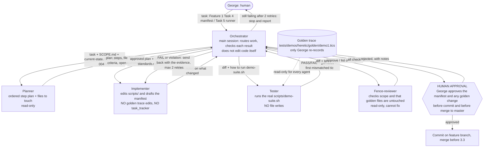

# GIMPL Orchestration Diagram

How work moves through the GIMPL agent team for one task. The first task run through it is Feature 1 on `feature/per-tic-demo-suite`: Task 4 (the `tests/demos/heretic/manifest`) and Task 5 (the real `scripts/demo-suite.sh` runner). The same loop is the skeleton for later Rust ports.

The Orchestrator is the main Claude Code session (instructions in `CLAUDE.md`, definition in `.claude/agents/orchestrator.md`). The four subagents live in `.claude/agents/`. Full tool grants and the risk behind each withheld tool are in `docs/routing-and-tool-grant-map.md`.

## What the Orchestrator checks on each return

| Returned by | Passes when | If not |
|---|---|---|
| Planner | Every step names its files, done criteria are testable, and nothing touches golden traces | Re-invoke the Planner once with the gap named; if still unclear, ask George |
| Implementer | The diff touches only files in the approved plan and no file under `tests/demos/heretic/golden/` | Send back with the out-of-scope paths (counts as a retry) |
| Tester | `demo-suite.sh` reports DEMO1 at 4227 gametics, decided from the output, not the exit code (255 is normal per decision-006) | Send the failure and first mismatched tic to the Implementer (counts as a retry) |
| Fence-reviewer | Approves with no violations | Send the violation list to the Implementer (counts as a retry) |

After 2 retries the Orchestrator stops and reports to George instead of looping. No agent re-records or edits a golden trace. If a run seems to need that, the Orchestrator stops and asks George (coding standard 4).
